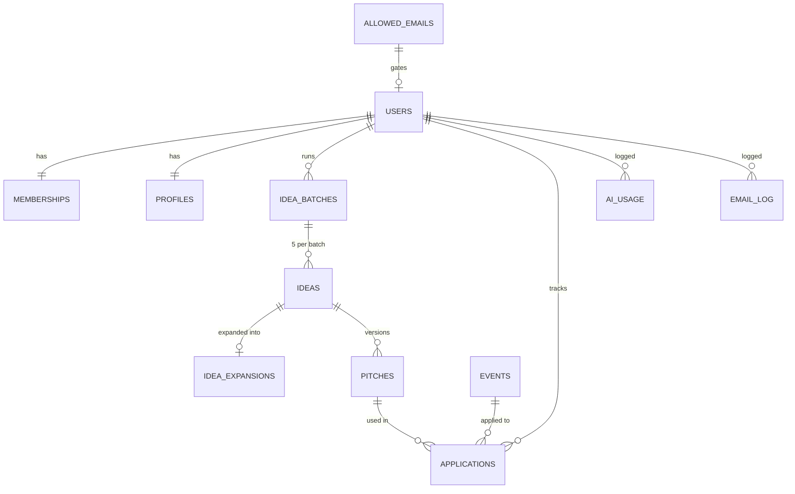

# TEDx Engine Rebuild Plan

As of 30 Oct 2026 · Ash Akshay Goel

## Summary

We rebuild TEDx Engine as a 4-step coach that takes an author from profile to a tracked TEDx application. It keeps the current flow (Profile, Idea, Pitch, Events) and fixes 9 problems found in the code review, such as a Step 4 that can never be completed.

**Who it serves:** authors and experts in a paid membership (today, India Authors Academy "Diamond Members") who want to speak at a TEDx event.

**What a member gets:**

- A speaker profile, filled in once and reused everywhere.
- 5 AI talk ideas at a time, with the chosen one expanded into a thesis and key points.
- A ready-to-send application: talk title, description, speaker bio and email pitch.
- A list of upcoming TEDx events, ranked by location and topic.
- A tracker for every application, from "Applied" to "Accepted" or "Declined."

**Goals of the rebuild:**

1. Every step can be finished, and the Dashboard tells the truth.
2. Nothing the AI writes is lost. Every idea, expansion and pitch is saved.
3. Admins can manage access, events and members without opening the database.
4. AI use is logged and capped, so costs stay predictable.
5. Members outside India can use it.

**Out of scope for version 1:** sending emails to TEDx organizers from the app, coaching calls, and video or slide tools.

## How the current app works

The live app at growth.indiaauthorsacademy.com is a React front end on Supabase, with 3 AI functions on the server. This table is what the code shows today, as of the review on 30 Oct 2026.

| Area | What it does today | Stored? |
| --- | --- | --- |
| Login | Email only. Checks `is_email_allowed`, then sends a magic link. Not allowed shows "Access Restricted, contact IAA Admin." | Login only |
| Dashboard | Step done if: name + city + expertise filled; an idea is selected; any pitch exists; any application exists | Reads only |
| Profile | Name, city, state (Indian states), country locked to "India", expertise, bio, book summary. Draft kept in the browser until Save | Yes, update only |
| Generate ideas | Needs bio + expertise. Sends name, expertise, bio, book summary to `generate-ideas`. Returns 5 ideas | No |
| Select idea | Unselects old ideas, inserts the new one as selected, calls `expand-idea` for thesis, why it matters, key points | Idea yes, expansion no |
| Pitch page load | Loads newest pitch (any idea) and the selected idea, then calls `expand-idea` again | No |
| Generate pitch | Sends profile + "title: description" to `generate-pitch`. Inserts a new pitch row each time | Yes, new row |
| Events | Events dated 30 to 120 days ahead. Score 3 for same city, 2 same state, 1 same country. Sorted by score, then date. 25 per page | Reads only |
| Apply Now | Opens the ted.com event page in a new tab | Nothing |

The AI prompts, model and limits live on the server and were not visible from the browser.

## User roles and permissions

The new app has 4 roles: Visitor, Member, Admin and System. A person's role is stored on their account, never decided by the browser.

| Role | Who | Can do | Cannot do |
| --- | --- | --- | --- |
| Visitor | Anyone not logged in | See the login page. Request a magic link. See "Access Restricted" if not on the allowed list | See any member data |
| Member | A logged-in person whose access is active | Read and edit only their own profile, ideas, pitches and applications. Read all published events. Use AI up to their daily limit | See other members. Edit events. Change their own role or limit |
| Admin | GBP or IAA staff | Everything a Member can, plus: manage access, add and edit events, view any member's progress, change AI limits, see reports, export data | Read login tokens. Delete audit logs |
| System | Server jobs and AI functions | Create profiles at signup, load events, write AI results and usage logs, send reminder emails | Act as a member from the browser |

**Access states for a member** (stored on the Membership record):

1. **Invited:** email is on the allowed list, but they have never logged in.
2. **Active:** can log in and use everything.
3. **Paused:** can log in and read their work, but cannot generate with AI. Used when a payment fails.
4. **Removed:** cannot log in. Their data is kept for 90 days, then deleted.

**Database rules to switch on (row-level security):**

- profiles, ideas, idea_expansions, pitches, applications: a member reads and writes only rows where `user_id` is their own id.
- events: everyone logged in can read rows with `status = published`. Only admins write.
- memberships, ai_usage, audit_log, email_log: members read only their own row (or none). Only System and Admins write.
- Admin check uses a server function such as `is_admin()`, never a value sent from the browser.

## Data model

The app stores 12 things. Each member has one profile and one membership, many ideas, pitches and applications. Events are shared by everyone. Every table has `id` (uuid), `created_at` and `updated_at` unless noted.

Read it from the login down: a user has one membership and one profile, ideas come in batches, and an application joins a member's pitch to a shared event. Three logs (ai_usage, email_log, audit_log) are written by System.

### 1. users (built in to Supabase Auth)

| Field | Type | Notes |
| --- | --- | --- |
| id | uuid | Primary key, used as `user_id` everywhere |
| email | text | Unique, lower case |
| last_sign_in_at | timestamp | Set by Supabase |

### 2. allowed_emails

| Field | Type | Notes |
| --- | --- | --- |
| email | text | Unique, lower case |
| tier | text | "Diamond" today; room for others |
| source | enum | manual, csv_import, payment, membership_sync |
| added_by | uuid | Admin user id, empty if System |
| expires_at | timestamp | Optional end of access |

### 3. memberships (one per user)

| Field | Type | Notes |
| --- | --- | --- |
| user_id | uuid | Unique, links to users |
| role | enum | member, admin |
| status | enum | invited, active, paused, removed |
| tier | text | Copied from allowed_emails at signup |
| daily_ai_limit | int | Default 20 AI calls a day |
| external_customer_id | text | Payment or membership system id |

### 4. profiles (one per user)

| Field | Type | Notes |
| --- | --- | --- |
| user_id | uuid | Unique |
| full_name | text | Required |
| city | text | Required |
| state_region | text | Free text, with an Indian states list as suggestions |
| country | text | Required, ISO code, any country |
| expertise | text | Required, 3 to 120 characters |
| bio | text | Required, 50 to 1,000 characters |
| book_title | text | Optional |
| book_summary | text | Optional, up to 2,000 characters |
| topics | text[] | Up to 5 tags, used to match events |
| linkedin_url, website_url | text | Optional, used in the speaker bio |
| photo_url | text | Optional headshot |
| is_complete | bool | True when all required fields pass |

### 5. idea_batches

| Field | Type | Notes |
| --- | --- | --- |
| user_id | uuid | Owner |
| profile_snapshot | jsonb | The profile used to generate, so results can be explained later |
| ai_usage_id | uuid | Links to the AI call |

### 6. ideas (many per batch)

| Field | Type | Notes |
| --- | --- | --- |
| user_id | uuid | Owner |
| batch_id | uuid | Links to idea_batches; empty for ideas the member types in |
| title | text | Required |
| description | text | One to three sentences |
| status | enum | suggested, selected, archived |
| is_favorite | bool | Lets members keep ideas they like |

Rule: only one idea per user can have `status = selected` (a partial unique index).

### 7. idea_expansions (one per idea)

| Field | Type | Notes |
| --- | --- | --- |
| idea_id | uuid | Unique |
| core_thesis | text | |
| why_it_matters | text | |
| key_points | text[] | 3 to 5 points |

### 8. pitches (many per idea)

| Field | Type | Notes |
| --- | --- | --- |
| user_id | uuid | Owner |
| idea_id | uuid | Required |
| version | int | 1, 2, 3 per idea |
| talk_title | text | Editable by the member |
| talk_description | text | Editable |
| speaker_bio | text | Editable |
| email_pitch | text | Editable |
| is_current | bool | One current pitch per idea |
| edited_by_member | bool | True once the member changes any field |

### 9. events

| Field | Type | Notes |
| --- | --- | --- |
| ted_event_id | text | Unique, the number at the end of the ted.com link |
| name | text | |
| city, state_region, country | text | |
| event_date | date | |
| speaker_deadline | date | Optional, when known |
| theme | text | Optional |
| topics | text[] | For matching with profile topics |
| apply_url | text | Speaker form if known, else the ted.com page |
| source | enum | ted_import, admin |
| status | enum | draft, published, past, cancelled |
| last_synced_at | timestamp | |

### 10. applications (many per user)

| Field | Type | Notes |
| --- | --- | --- |
| user_id | uuid | Owner |
| event_id | uuid | Required |
| pitch_id | uuid | The pitch they sent |
| status | enum | planned, applied, follow_up, interview, accepted, declined, withdrawn |
| applied_on | date | |
| next_action_on | date | Drives reminder emails |
| notes | text | Private to the member |

Rule: one application per user per event (unique on `user_id, event_id`).

### 11. ai_usage

| Field | Type | Notes |
| --- | --- | --- |
| user_id | uuid | |
| function | enum | generate_ideas, expand_idea, generate_pitch |
| model | text | Model name used |
| prompt_version | text | Example: ideas-v3 |
| input_tokens, output_tokens | int | |
| cost_usd | numeric | |
| status | enum | ok, error, blocked_limit |

### 12. email_log and audit_log

| Table | Fields |
| --- | --- |
| email_log | user_id, template, to_email, sent_at, provider_id, status |
| audit_log | actor_id, action, table_name, row_id, before, after, created_at |

## Member screens

Members see 8 screens. Every screen after login shares a sidebar: Dashboard, Profile, Ideas, Pitch, Events, My Applications, Account, Sign out.

### M1. Login (`/login`)

- **Shows:** logo, "Enter your email to get started," email field, Send Login Link button.
- **States:** email form; "Check your email" with Resend (after 60 seconds) and Use a different email; "Access Restricted" with a Contact support link (mailto, set by admin) and Try another email.
- **Rules:** same message whether or not the email exists, so people cannot test which emails are members. Limit 5 link requests per email per hour.

### M2. Dashboard (`/`)

- **Shows:** welcome line with first name; progress bar (X of 4); 4 step cards (Profile, Idea, Pitch, Apply) each with Completed, In progress or Not started and a button to that page; "Next step" card that names the single next thing to do; upcoming deadlines (next 3 applications with `next_action_on` in 14 days); AI uses left today.
- **Step rules:** Profile done = `profiles.is_complete`. Idea done = a selected idea exists. Pitch done = a current pitch exists for the selected idea. Apply done = at least one application with status applied or later.

### M3. Profile (`/profile`)

- **Fields:** full name, city, state or region, country (dropdown, all countries, default India), expertise, topics (tag picker, up to 5), bio with a character counter, book title, book summary, LinkedIn, website, headshot upload.
- **Buttons:** Save Profile; Discard changes. Leaving with unsaved changes asks "Leave without saving?"
- **Rules:** required fields are marked with an asterisk and checked before saving. The draft still lives in the browser until Save. After first save, show "Next: generate talk ideas" button.

### M4. Ideas (`/ideas`)

- **Top:** Currently Selected Idea card (title, description, View expansion, Go to Pitch).
- **Generate area:** Generate 5 Ideas button, optional "Steer the ideas" text box (for example "focus on women founders"), AI uses left today.
- **Idea list:** every saved idea, newest batch first, with tabs All, Favorites, Archived. Each card: title, description, Select This Idea, star (favorite), Archive.
- **Add your own:** a small form to type a title and description without AI.
- **Expansion panel:** core thesis, why it matters, key points, Regenerate expansion, Continue to Pitch.
- **Blocked state:** if profile is incomplete, the button is replaced by "Finish your profile first" with a link listing the missing fields.

### M5. Pitch (`/pitch`)

- **Top:** selected idea and its saved expansion (no new AI call on load).
- **If no pitch for this idea:** Generate Pitch button.
- **Pitch editor:** 4 editable cards: Talk Title (max 100 characters), Talk Description (max 1,000), Speaker Bio (max 600), Email Pitch (subject line + body). Each has Copy and Reset to AI version.
- **Buttons:** Save edits, Regenerate (makes version N+1, keeps old versions), Version history dropdown, Download as Word or PDF, Find events.
- **Rule:** if the selected idea changes, this page shows the pitch for the new idea, not the old one.

### M6. Events (`/events`)

- **Filters:** date range (default today to 180 days), country, state, city, topic, "Only events matching my topics" switch, search by name.
- **Each card:** name, city, date, speaker deadline if known, match tags (In your city, In your state, Topic match), Open on TED (new tab), Track this event.
- **Track this event:** creates an application with status planned and opens it.
- **Empty state:** "No events match these filters" with Clear filters.
- **Paging:** 25 per page.

### M7. My Applications (`/applications` and `/applications/:id`)

- **List:** table with event, date, pitch used, status (dropdown), next action date, last updated. Filter by status. Sort by next action.
- **Detail:** event info, pitch used (with Copy buttons), status, applied on, next action date, private notes, Open on TED, Mark as applied, Withdraw.

### M8. Account (`/account`)

- **Shows:** email, membership tier and status, AI uses today and this month, Download my data (JSON and PDF), Delete my account (asks to type DELETE), email preferences (reminders on or off).

### Also needed

- **404 page** with a link to Dashboard.
- **Error banner** for failed AI calls: "That didn't work. You weren't charged a use. Try again."

## Admin screens

Admins get 6 more screens under `/admin`, shown in the sidebar only when `memberships.role = admin`. None of these exist today; admin work now happens in the Supabase dashboard.

| # | Screen | URL | What it shows | Main actions |
| --- | --- | --- | --- | --- |
| A1 | Admin home | `/admin` | Members by status, new signups this week, step funnel (Profile, Idea, Pitch, Applied), AI cost this month, failed AI calls | Jump to any list below |
| A2 | Access | `/admin/access` | Allowed emails: email, tier, source, added by, expires, has logged in | Add one email, import CSV, remove, set expiry, resend invite |
| A3 | Members | `/admin/members` and `/admin/members/:id` | Name, email, status, step reached, last active, AI uses this month. Detail shows profile, ideas, pitches, applications (read only) | Pause, reactivate, remove, change role, change AI limit, export member data |
| A4 | Events | `/admin/events` and `/admin/events/:id` | All events with status, source, date, last synced, number of members tracking it | Add, edit, publish, unpublish, mark cancelled, run TED import now, merge duplicates |
| A5 | AI settings | `/admin/ai` | Model per function, prompt text and version, default daily limit, usage and cost by day | Edit prompt (saves a new version), test prompt with a sample profile, roll back a version |
| A6 | Reports and logs | `/admin/reports` | Funnel by week, applications by status, accepted talks, emails sent and bounced, audit log | Download CSV for any report |

**Rules for every admin screen:** every change writes a row to `audit_log`; deleting is a two-step confirm; admins never see magic-link tokens or passwords.

## Workflows

There are 9 workflows: 6 for members, 3 for admins and System. Each step names the table it writes.

### W1. Get access and log in

1. Admin adds the email (A2), or a payment or membership sync adds it. Writes `allowed_emails`.
2. System sends the welcome email with the login link. Writes `email_log`.
3. Member enters email on M1. Server checks `allowed_emails` and `memberships.status`.
4. Allowed: send magic link. Not allowed or removed: show Access Restricted.
5. First login: System creates `memberships` (status active, role member, tier copied) and an empty `profiles` row.
6. Member lands on Dashboard with "Start with your profile."

### W2. Complete the profile

1. Member fills M3. Draft is saved in the browser as they type.
2. Save checks required fields. Errors show under each field.
3. Server saves `profiles` and sets `is_complete`.
4. Dashboard step 1 shows Completed. "Next: generate talk ideas" appears.

### W3. Generate and choose an idea

1. Member clicks Generate 5 Ideas (optional steer text).
2. Server checks: profile complete, membership active, AI uses left today. Fails: show the reason, no AI call.
3. Server calls the AI with profile + steer text + prompt version. Writes `ai_usage`.
4. Server saves `idea_batches` and 5 `ideas` (status suggested). Screen shows them.
5. Member selects one. In one transaction: old selected idea becomes suggested, new one becomes selected.
6. If no `idea_expansions` row exists, server calls the AI once and saves it. Otherwise reuse it.
7. Member reads the expansion and clicks Continue to Pitch.

### W4. Create and edit the pitch

1. Pitch page loads the selected idea, its saved expansion, and the current pitch for that idea.
2. No pitch yet: member clicks Generate Pitch. Server checks limits, calls AI with profile + idea + expansion, saves `pitches` version 1 as current.
3. Member edits any card and clicks Save edits. Sets `edited_by_member = true`.
4. Regenerate asks "This makes a new version. Your edits stay in version history." Then saves version N+1 as current.
5. Copy buttons copy one card. Download makes a Word or PDF file of all 4 cards.

### W5. Find and track events

1. Events page loads published events from today to 180 days ahead.
2. Each event gets a score: same city 3, same state 2, same country 1, plus 2 for each topic shared with the profile.
3. Sort by score, then by speaker deadline (or event date if none).
4. Member clicks Track this event. Writes `applications` (status planned, current pitch attached).
5. Member clicks Open on TED, applies on the TED or organizer site outside the app.

### W6. Update an application

1. Member comes back and sets status to applied, adds applied on date and a next action date (default 14 days later).
2. Dashboard step 4 shows Completed once any application is applied or later.
3. On the next action date, System sends a reminder (W9).
4. Member updates to interview, accepted, declined or withdrawn. Accepted shows a congratulations banner and notifies admins.

### W7. Admin manages access

1. Add one email or import a CSV (columns: email, tier, expires_at).
2. Pause a member: they keep read access, AI buttons are disabled with "Your membership is paused."
3. Remove a member: login blocked at once; data deleted after 90 days by W9.

### W8. Load and clean events

1. Weekly, System imports upcoming TEDx events (source to be decided, see Open questions).
2. New events land as draft. Changed events update in place, matched on `ted_event_id`.
3. Admin reviews drafts in A4, adds topics and deadlines, and publishes.
4. Nightly, System marks events with a past date as past. They drop off member lists.

### W9. Nightly System jobs

1. Mark past events.
2. Send reminder emails for applications with `next_action_on` = today.
3. Send a nudge to members stuck on one step for 7 days (once per step).
4. Delete data of members removed more than 90 days ago.
5. Reset nothing: daily AI limits are counted from `ai_usage` by date, so no reset is needed.

## What happens out of view

Thirteen things happen on servers or outside the app. For each one, this table gives what happens today and the decision proposed for the new version.

| # | Process | Today | Proposed decision |
| --- | --- | --- | --- |
| 1 | Login emails | Supabase default magic-link email | Send from our own domain with branded templates. Use a mail service (for example Resend or Postmark). Log in `email_log` |
| 2 | Who gets access | Hidden allowed list, filled by hand or by a sync we cannot see | Admin screen A2 plus CSV import. Later, a webhook from the payment or membership system adds and removes emails |
| 3 | Payments | None in the app. Access comes from a membership paid elsewhere | Version 1: no payments in the app. Access follows membership status. Version 2: optional direct purchase with Stripe |
| 4 | Profile creation | Blank profile must exist before Save works; likely made at signup | System creates membership and profile on first login (W1). Save also creates the row if missing |
| 5 | Loading events | Someone or something fills the events table from ted.com | Weekly import job plus admin review (W8). Every event has a source and last synced date |
| 6 | AI generation | 3 server functions; prompts, model, cost and limits hidden. No limit on clicks | Prompts stored and versioned in A5. Every call logged in `ai_usage`. Default 20 calls a day per member. Failed calls do not count |
| 7 | Permissions | Not visible from the browser; row-level security not confirmed | Row-level security on every table as set out in User roles. Test with 2 member accounts before launch |
| 8 | Admin role | "Contact IAA Admin" but no admin area | Admin role on `memberships` plus screens A1 to A6 |
| 9 | Application tracking | Nothing ever writes an application | Track this event and My Applications (W5, W6) |
| 10 | Emails to TEDx organizers | Not sent by the app; member copies the pitch | Keep manual in version 1. Add a mailto button that fills the subject and body |
| 11 | Analytics | Hosting platform scripts (`~flock.js`, `__l5e/trackevents`, `~api/analytics`) | One analytics tool chosen by us, page views and key events (profile saved, idea selected, pitch generated, event tracked). Listed in the privacy policy |
| 12 | Reports | None in the app | A6 reports with CSV download. Weekly summary email to admins |
| 13 | Reminders and nudges | None | W9 nightly job: next-action reminders and 7-day stuck nudges. Members can turn them off in M8 |

**Emails the new app sends** (all logged in `email_log`):

| Template | Sent to | When |
| --- | --- | --- |
| welcome_invite | New allowed email | Admin adds the email |
| magic_link | Member | Member requests login |
| stuck_nudge | Member | 7 days on the same step |
| next_action_reminder | Member | On an application's next action date |
| talk_accepted_alert | Admins | A member marks an application accepted |
| membership_paused | Member | Status set to paused |
| weekly_admin_summary | Admins | Mondays |

## Bugs and missing pieces

The current app has 9 bugs and 10 missing pieces. The table shows where each one is fixed in this plan.

**Bugs in the current app:**

| # | Bug | Effect on members | Fixed by |
| --- | --- | --- | --- |
| 1 | Nothing writes to `applications` | Dashboard stuck at 3 of 4 forever | W5, W6, M7 |
| 2 | Dashboard checks name + city + expertise; Ideas needs bio + expertise | Profile shows done, then Ideas refuses | One `is_complete` rule used everywhere |
| 3 | Pitch page shows newest pitch, not the one for the selected idea | Old pitch shown after switching ideas | `pitches.idea_id` + `is_current` per idea |
| 4 | The 5 generated ideas are never saved | Lost on refresh | `idea_batches` + `ideas` |
| 5 | Expansion not saved; re-made on every Pitch page visit | Extra AI cost; text changes between pages | `idea_expansions` |
| 6 | Every selection and pitch adds a row; nothing cleans up | Database fills with clutter | Statuses, versions, archive |
| 7 | "Near your city" means same state | Misleading label | Labels "In your city" and "In your state" |
| 8 | Events in the next 30 days are hidden | A local event next week never shows | Default range starts today |
| 9 | Country locked to India; expertise loaded but unused for events | Non-Indian members blocked; no topic matching | Country dropdown; topic score |

**Missing pieces:**

- [ ] Admin area (A1 to A6)
- [ ] Application tracker (M7)
- [ ] Editable pitches with version history
- [ ] AI usage log and daily limits
- [ ] Branded emails, reminders and nudges
- [ ] Event import job and review queue
- [ ] Account page with data download and delete
- [ ] Field checks and character limits on Profile
- [ ] Privacy policy and terms pages, linked from login
- [ ] Automated tests for row-level security

## Build phases and acceptance checks

Build in 4 phases. Each phase ends with checks that must all pass before the next one starts.

### Phase 1: Foundation

Tables, roles, row-level security, login, profile.

- [ ] All 12 tables created with the fields above.
- [ ] Member A cannot read or change any row of Member B (tested by script).
- [ ] An email not on the allowed list sees Access Restricted, and the same message timing as an allowed email.
- [ ] First login creates one membership and one profile, never two.
- [ ] Profile Save blocks with clear errors when required fields are empty.
- [ ] A member in Canada can save a profile.

### Phase 2: Ideas and pitch

AI functions, saved results, limits.

- [ ] Generated ideas survive a page refresh.
- [ ] Selecting an idea leaves exactly one selected idea.
- [ ] Opening the Pitch page makes zero AI calls when an expansion is saved.
- [ ] Switching ideas shows that idea's pitch, or Generate Pitch if it has none.
- [ ] Edits to a pitch survive a refresh; Regenerate keeps the old version.
- [ ] The 21st AI call in a day is refused with a clear message and logged as blocked_limit.
- [ ] Every AI call has a row in `ai_usage` with model, prompt version and cost.

### Phase 3: Events and applications

- [ ] Events in the next 7 days are shown.
- [ ] City, state and topic match tags are correct for 5 test profiles.
- [ ] Track this event creates one application; a second click opens the same one.
- [ ] Setting status to applied completes Dashboard step 4.
- [ ] Import job adds new events as draft and updates changed ones without duplicates.

### Phase 4: Admin, emails and reports

- [ ] Admin can add, import, pause and remove access; each action appears in `audit_log`.
- [ ] Non-admins get a 404 on every `/admin` URL.
- [ ] All 7 email templates send from our domain and are logged.
- [ ] Reminder sends once on the next action date, and never when turned off.
- [ ] Every report downloads as CSV with the same totals as on screen.

### Moving current members

1. Export `profiles`, `ideas` (selected only), `pitches` and the allowed list from the current Supabase project.
2. Map old fields: `name` to `full_name`, `state` to `state_region`, `book_summary` stays, `selected = true` to `status = selected`, newest pitch per idea becomes `is_current`.
3. Import into the new tables, then send a "We've upgraded" email with a login link.

## Open questions

These 10 choices change the build. The proposed default is what this plan assumes until you decide.

| # | Question | Proposed default |
| --- | --- | --- |
| 1 | Is this a GBP product, an India Authors Academy product, or white-labelled for both? | One app, brand set per membership tier |
| 2 | Where does access come from: manual list, a membership platform, or our own checkout? | Manual list + CSV in version 1 |
| 3 | Where do events come from, and are we allowed to import them from ted.com? | Admin-entered list first; check TED's terms before any import |
| 4 | Which AI model and what monthly AI budget? | One model for all 3 functions; daily limit of 20 calls per member |
| 5 | Do we keep the current prompts, or rewrite them in GBP's voice? | Get the current prompts from the Supabase project and review them |
| 6 | Should members outside India see Indian events only, or worldwide events? | Worldwide, ranked by location |
| 7 | Will admins coach members inside the app (comments on pitches)? | Not in version 1 |
| 8 | How long do we keep data after a member leaves? | 90 days |
| 9 | Who owns the build: an in-house developer, an agency, or a no-code tool? | To decide |
| 10 | Do we rebuild on the same Supabase project or start a new one? | New project, then move members (see Build phases) |
